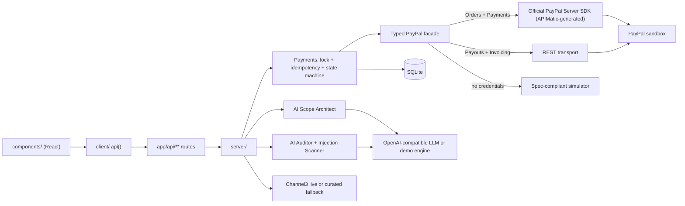

# PayPal MilestoneOS

**Autonomous AI-verified escrow, equipment procurement and milestone payouts built on PayPal.**

Clients normally pay freelancers upfront and hope for the best, or freelancers work with no payment guarantee. MilestoneOS puts an AI agent in front of PayPal's Orders v2 (authorize and capture), Payouts and Invoicing APIs. Money is held in escrow and is released only when the delivered work objectively meets the contract.

## Quick start

Requires Node.js 20 or newer.

```bash
npm install
npm run dev        # http://localhost:3000
```

No keys are needed to try it. Without a `.env`, PayPal, the LLM and Channel3 all fall back to realistic simulators and a banner says so.

To use live services, copy `.env.example` to `.env`, fill in the values and restart.

| Variable | Purpose | Without it |
|---|---|---|
| `NEXT_PUBLIC_PAYPAL_CLIENT_ID`, `PAYPAL_CLIENT_SECRET` | PayPal Sandbox app credentials (both required) | Simulated PayPal v2 responses |
| `PAYPAL_ENV` | `sandbox` (default) or `live` | `sandbox` |
| `OPENAI_API_KEY` | Key for any OpenAI-compatible LLM provider | Deterministic demo AI engine |
| `OPENAI_BASE_URL` | Provider endpoint (leave empty for OpenAI) | OpenAI |
| `OPENAI_MODEL` | Model name | `gpt-4o-mini` |
| `CHANNEL3_API_KEY` | Live product search | Curated fallback catalog |
| `DATABASE_PATH` | SQLite file | `./data/milestoneos.db` |
| `ENABLE_DEMO_TOOLS` | `false` removes demo mode entirely: no toggle, no seeded scenarios, and the demo-only endpoints return 403 | `true` |
| `NEXT_PUBLIC_DEFAULT_MODE` | `demo` or `user`: the mode the UI opens in before a user picks one | `demo` |

### Demo mode and end-user mode

A toggle in the top bar switches between two views (the choice is remembered in the browser).

| | Demo mode | End-user mode |
|---|---|---|
| Projects | Preloaded Scenarios 1-3 plus your own | Only your own projects (empty state with a create button) |
| Funding | PayPal button plus a 1-click simulated authorization | PayPal button only |
| AI audit | Test submissions (passing, failing, partial, injection) | Paste your own deliverable |
| Tabs | Sponsor-named, with the API telemetry inspector and drawer | Plain names and a user-facing audit trail |
| Extras | Reset demo data | none |

For a production deployment set `ENABLE_DEMO_TOOLS=false`; the toggle disappears and the demo endpoints (`/api/reset`, `/api/samples`, `/api/paypal/simulate-authorization`) are blocked on the server.

Free LLM options (no card): Google Gemini (`OPENAI_BASE_URL=https://generativelanguage.googleapis.com/v1beta/openai/`, `OPENAI_MODEL=gemini-flash-latest`) or Groq (`https://api.groq.com/openai/v1`, `llama-3.3-70b-versatile`). If a model call fails, the app falls back to the demo engine, so a flaky provider never breaks the demo.

For live PayPal sandbox payouts, enable the Payouts product on the sandbox app, fund the sandbox business account and use a real sandbox personal account email for the freelancer.

### Scripts

| Command | What it does |
|---|---|
| `npm run dev` | Development server |
| `npm run build` then `npm start` | Production build and server |
| `npm run lint` | Type-check (`tsc --noEmit`) |
| `npm test` | 25 tests: escrow, guardrails, idempotency, scoring, layering |

### Troubleshooting

- **`EINVAL readlink .next` on Windows/OneDrive:** delete the `.next` folder and rebuild, or exclude it from OneDrive sync.
- **Env changes not picked up:** Next.js reads `.env` at startup. Restart the server.
- **Reset demo data:** use the reset icon in the top bar, or `POST /api/reset`.

## What it does

1. **AI Scope Architect** is a small agent, not a single prompt. It first lists everything the brief asks for (and what the project needs but the client did not say, such as cart and checkout for a store), plans milestones that each cover one deliverable, then reviews its own plan with deterministic checks (every requirement covered, balanced payments, no bundled work, specific verifiable criteria) and sends it back with the exact problems if it fails. The dashboard shows what it understood and which milestone delivers each requirement. Without a model key it falls back to a rule-based planner and says so.
2. **Escrow funding** with the official `@paypal/react-paypal-js` buttons (`intent: authorize`) or a 1-click sandbox simulation. Funds are held, not captured.
3. **AI Deliverable Auditor** scores a submission against each acceptance criterion in a live agentic terminal. Work can be pasted text, a public GitHub, GitLab or Bitbucket link, or an uploaded folder or `.zip`.
   - For repositories the agent downloads the code with strict size and host limits, never executes it, and works from evidence: it retrieves the code behind each requirement, a model (when configured) judges it, and every score must be backed by quotes that exist verbatim in the named file. README claims do not count as implementation.
   - Integrity checks catch stub functions, starter templates, copy-pasted padding, hard-coded secrets, forks with no new commits, commit history that pre-dates the milestone, and instructions aimed at the auditor hidden in docs or comments. Suspicious work is capped below the release threshold, so a human reviews it instead of the funds moving automatically.
   - Score 80 or higher: the server captures the authorization and pays out the freelancer.
   - 50 to 79: funds stay locked and a pro-rated settlement is offered (final capture of the agreed amount, remainder released to the client).
   - Below 50: funds stay locked and a line-by-line revision checklist is produced.
   - Prompt-injection attempt: score 0, status `SECURITY_FLAGGED`, no PayPal call, alert in the audit trail.
4. **Channel3 procurement** sources real products for the stipend and re-verifies price and stock before any PayPal order is created.

Three one-click demo scenarios are preloaded (SaaS pricing page, creator video ads, smart-contract audit) and any brief can be turned into a new project.

## Project structure

The app is one Next.js project with a strict three-layer split. `shared` and `client` never import from `server`, and a test enforces it.

```
src/
  app/                    Next.js App Router
    page.tsx, layout.tsx    pages (frontend entry)
    api/**/route.ts         HTTP layer of the backend (thin handlers: validate, call server/, respond)
  components/             Frontend UI (React): Command Center, AG Grid ledger, timeline,
                          marketplace, telemetry, modals
  client/                 Frontend-only helpers: fetch wrapper (ApiError), formatters, status styling,
                          Bryntum Gantt data builder
  shared/                 Isomorphic code used by both sides: domain types, cn(), keyword helper,
                          test-submission samples
  server/                 Backend only (Node)
    payments.ts             funding, release, settlement, void/refund, receipt (locks + idempotency)
    audit-flow.ts           audit -> verdict -> release orchestration
    procurement.ts          Channel3 price guard and product approval
    repo.ts, db.ts          SQLite access (better-sqlite3)
    seed.ts, items.ts       demo scenarios and ledger row factories
    channel3.ts             Channel3 client + curated fallback catalog
    env.ts, errors.ts, http.ts, utils.ts
    paypal-sdkClient.ts     entry point of the typed PayPal SDK
    apimatic-paypal/        models, typed facade with telemetry, transports:
                            official PayPal Server SDK (Orders/Payments), REST (Payouts/Invoicing), simulator
    ai/                     scope architect, auditor, injection scanner, demo engine, LLM client
tests/                    node:test suites (run with tsx)
```

Request flow: component -> `client/helpers.ts` `api()` -> `app/api/**/route.ts` -> `server/*` -> SQLite / PayPal / LLM / Channel3.

## API reference

| Endpoint | Purpose |
|---|---|
| `GET /api/env` | Which integrations are live |
| `GET/POST /api/projects`, `GET/DELETE /api/projects/[id]` | List, create (AI scope), read, delete projects |
| `POST /api/paypal/create-order` | Orders v2 order with `intent: AUTHORIZE` |
| `POST /api/paypal/authorize-order` | Authorize after buyer approval (funds held) |
| `POST /api/paypal/simulate-authorization` | 1-click sandbox authorization |
| `POST /api/audit` | Streams the AI audit (NDJSON), then captures and pays out if approved |
| `POST /api/paypal/capture-and-payout` | Server-guarded release and safe payout retry (needs a stored passing audit) |
| `POST /api/items/[id]/settlement` | Accept or decline a pro-rated settlement |
| `POST /api/paypal/void-or-refund` | Void an authorization or refund a capture |
| `POST /api/paypal/receipt` | Receipt plus a PayPal Invoicing draft |
| `GET /api/channel3/search`, `POST /api/items/[id]/candidates`, `POST /api/items/[id]/approve-product` | Procurement |
| `POST /api/items/[id]/amount` | Edit an unfunded milestone amount |
| `POST /api/samples` | Test deliverables (LLM-written for custom projects) |
| `GET /api/telemetry`, `POST /api/reset` | API telemetry, reset demo data |

## Architecture



## How PayPal APIs and AI work together

| Step | PayPal API | Who triggers it |
|---|---|---|
| Fund escrow | `POST /v2/checkout/orders` (`intent: AUTHORIZE`) then `POST /v2/checkout/orders/{id}/authorize` | Client (PayPal button) |
| Release | `POST /v2/payments/authorizations/{id}/capture` | Server, only after a stored passing audit (or both parties accepting a settlement) |
| Pay freelancer | `POST /v1/payments/payouts` | Server, right after capture |
| Cancel or settle | `POST /v2/payments/authorizations/{id}/void`, `POST /v2/payments/captures/{id}/refund` | Client / server |
| Receipt | `POST /v2/invoicing/invoices` (draft) | Server, on demand |

The LLM only produces per-criterion scores. The overall score, the verdict and the decision to move money are computed by server code, and the capture route refuses to run without a recorded passing audit.

## Guardrails

1. **Sub-threshold deliverable:** Capture is never called; status `REVISION_NEEDED`; checklist of fixes.
2. **Partial acceptance (50-79):** pro-rated settlement, e.g. $450 of $600; capture with `final_capture: true`; holdback returned to the client.
3. **Prompt injection:** normalized scan (zero-width and Unicode tricks) before grading; blocked, scored 0, logged as an alert.
4. **Idempotency:** `PayPal-Request-Id = sha256(milestoneId + authId)` for capture (payout adds a `:payout` suffix), a DB compare-and-set lock (`IS_PROCESSING_PAYMENT`) and stored step results so retries and double-clicks never pay twice.
5. **Authorization expiry:** amber badge after 25 days and a one-click re-authorize that voids the old hold.
6. **Channel3 price guard:** live price must be at or below the approved cap or auto-checkout is blocked and in-budget alternatives are suggested.
7. **Missing keys:** never crashes; banner plus simulated PayPal v2 payloads with latency.

## Sponsor tools

- **AG Grid** (`ag-grid-community`, `ag-grid-react`): `components/EscrowLedgerGrid.tsx` with custom cell renderers (status pills, score bars, copyable PayPal IDs, context-aware actions), quick filter, inline editing of unfunded amounts, a pinned totals row, "Group by type" (built with full-width group rows because native row grouping is an Enterprise feature) and CSV export (`Export CFO Audit Log`). It also uses AG Grid's light and dark Quartz themes (switching live with the app theme), external filtering (state chips with live counts), expandable master/detail rows built from full-width rows plus `postSortRows` (acceptance criteria with per-criterion audit scores, the PayPal escrow timeline and the latest audit), multi-row selection with a live selected-total bar and `Export selected`, floating column filters, a custom `usd` cell data type, cell change flashing and a persisted column chooser.
- **Bryntum** (`@bryntum/gantt`, installed as an npm alias of the public `@bryntum/gantt-trial` build, so it shows Bryntum's trial notice): `components/BryntumTimeline.tsx` renders the real Bryntum Gantt with the milestone schedule, finish-to-start dependencies, a today line and zero-duration payment-unlock milestones that feed a final payout milestone (data built in `client/ganttData.ts`). Clicking a task opens the inspector and highlights the AG Grid row, and selecting a row in the grid scrolls the Gantt to its task. Beyond display it is interactive: a right-click task menu drives the escrow lifecycle (fund, run the AI audit, view receipt), PayPal authorization expiry is drawn as a deadline indicator, and critical-path, progress-line, amount labels, zoom controls and a shared-project Timeline overview widget are included. Both light and dark themes are supported (`npm run theme:bryntum` regenerates the scoped theme stylesheet). If the library fails to load, `components/TimelineView.tsx` falls back to the built-in `MilestoneTimeline.tsx`. Replace the trial with a licensed `@bryntum/gantt` for production.
- **Channel3** (`server/channel3.ts`): `POST https://api.trychannel3.com/v1/search` with `x-api-key` and a price filter; automatic fallback to a curated catalog when no key is set or the call fails.
- **APIMatic** (`server/apimatic-paypal/`, `server/paypal-sdkClient.ts`): live Orders v2 and Payments v2 calls (create order, authorize, capture, void, refund) go through PayPal's official Node SDK, `@paypal/paypal-server-sdk`, which is generated by APIMatic (`official-sdk-transport.ts`). That SDK has no Payouts or Invoicing controllers, so those two use a typed REST transport, and the no-keys simulator replaces both. Every call goes through one typed facade that records headers, request and response bodies, latency, the transport used and `PayPal-Request-Id`, shown in the telemetry drawer and Inspector tab (a `PAYPAL SERVER SDK` badge marks calls made through the official SDK).
- **Render** (`render.yaml`): one web service. Build `npm install && npm run build`, start `npm start`. Add the secret variables in the Render dashboard. The free tier has an ephemeral disk, so demo data is re-seeded on boot.

## License

MIT (see `LICENSE`).
